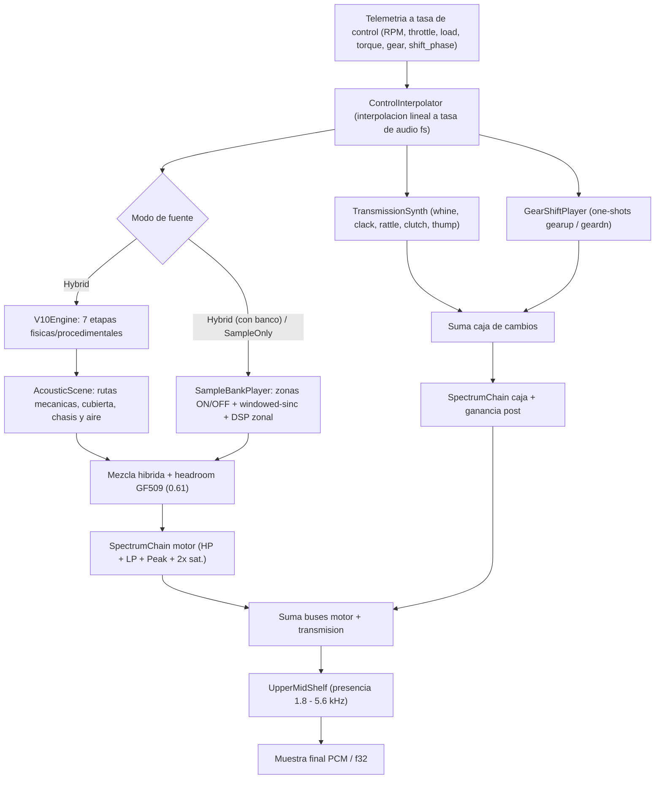

# Arquitectura, Física, Matemáticas y Pseudocódigo de Síntesis de Audio de Motor (`v2`)

Este documento describe de principio a fin cómo genera audio el motor de síntesis en tiempo real implementado en [v2/src](file:///d:/rust-engine-sim/v2/src/lib.rs), combinando termodinámica 0D/1D, propagación acústica en guías de onda y resonadores modales, escena acústica del chasis, reproducción híbrida de muestras (*sample bank*) y modelado procedural de transmisión.

---

## 1. Visión general de la cadena de señal

El sistema opera bajo un contrato estricto de **tiempo real sin asignaciones en heap en el hilo de audio** (*audio callback*). Toda memoria (tablas de volumen, líneas de retardo circulares, tablas windowed-sinc, bancos modales) se reserva una sola vez al inicializar [AudioRenderer](file:///d:/rust-engine-sim/v2/src/runtime/renderer.rs).



---

## 2. Paso 0: Interpolación de telemetría (Control → Audio)

La simulación del vehículo envía estados a menor frecuencia (p. ej. 60–240 Hz, periodo $\Delta t_{\text{ctrl}}$), mientras que el DSP corre muestra a muestra a $f_s$ (típicamente $48\,000\text{ Hz}$). Para evitar escalones audibles (*zipper noise*), [ControlInterpolator](file:///d:/rust-engine-sim/v2/src/control/interpolation.rs) interpola linealmente las 8 señales continuas:

$$
N = \operatorname{round}(\Delta t_{\text{ctrl}} \cdot f_s), \qquad
\Delta x_k = \frac{x_{k,\text{target}} - x_{k,\text{actual}}}{N}
$$

Los estados discretos (`torque_sign`, `gear`, `shift_phase`, `rev_limiter_active`) se propagan sin retardo en cuanto cambia la telemetría.

```text
FUNCION update_telemetry(telemetria, fs):
    validar(telemetria)
    N = round(telemetria.dt_seconds * fs)
    SI N > 0:
        PARA cada campo continuo k en [rpm, throttle, load, torque, d_rpm, d_thr, clutch, tc_cut]:
            step[k] = (telemetria[k] - rendered[k]) / N
    rendered.discretos = telemetria.discretos

FUNCION next_sample():
    SI remaining > 0:
        rendered.continuos += step
        remaining -= 1
        SI remaining == 0: rendered.continuos = target.continuos  // evita deriva float
    DEVOLVER rendered
```

---

## 3. Etapa 1: Energía acústica, seguimiento asimétrico y cinemática del cigüeñal

### 3.1 Energía acústica objetivo y seguidor asimétrico

Incluso sin acelerador (*overrun / coast*), un motor bombeando aire y reteniendo por fricción/compresión mantiene energía acústica proporcional al régimen. En [energy.rs](file:///d:/rust-engine-sim/v2/src/control/energy.rs):

$$
r_{\text{norm}} = \operatorname{clamp}\left(\frac{\text{RPM} - \text{RPM}_{\text{idle}}}{\max(\text{RPM}_{\max} - \text{RPM}_{\text{idle}}, 1)},\ 0,\ 1\right)
$$

$$
E_{\text{coast}} = 0.12 + 0.20\, r_{\text{norm}}
$$

$$
E_{\text{powered}} = 0.25\, u_{\text{throttle}} + 0.63\, u_{\text{load}}\,(0.35 + 0.65\, u_{\text{throttle}})
$$

$$
E_{\text{retention}} = \max(-\tau_{\text{norm}}, 0) \cdot c_{\text{clutch}} \cdot 0.08
$$

$$
E_{\text{target}} = \operatorname{clamp}\Big(E_{\text{coast}} + E_{\text{powered}} \cdot g_{\text{cut}}(\text{shift\_phase}) \cdot g_{\text{lim}} + E_{\text{retention}},\ 0,\ 1\Big)
$$

donde:
- $g_{\text{cut}} = 0.12$ durante corte de encendido (`UpshiftCut` = 1, `DownshiftCut` = 3), $0.72$ en recuperación (`2` ó `5`), y $1.0$ en marcha estable.
- $g_{\text{lim}} = 0.78$ si el limitador de RPM está activo ($1.0$ en otro caso).

El seguidor de envolvente ([EnergyFollower](file:///d:/rust-engine-sim/v2/src/control/energy.rs)) separa la respuesta instantánea del gas ($\tau_{\text{att}} = 18\text{ ms}$) de la inercia térmica/acústica al soltar el acelerador ($\tau_{\text{rel}} = 413\text{ ms}$):

$$
\alpha =
\begin{cases}
1 - e^{-1 / (0.018 f_s)} & \text{si } E_{\text{target}} > E[n-1] \\
1 - e^{-1 / (0.413 f_s)} & \text{si } E_{\text{target}} \le E[n-1]
\end{cases}
$$

$$
E[n] = E[n-1] + \alpha\,(E_{\text{target}} - E[n-1])
$$

### 3.2 Gesto de cambio (*ShiftGesture*) y microderiva orgánica

Para evitar que el seguidor asimétrico rectifique oscilaciones rápidas, el gesto de cambio se multiplica **después** de $E[n]$ ([shift_gesture.rs](file:///d:/rust-engine-sim/v2/src/control/shift_gesture.rs)):

- **Wobble de recuperación** (tras entrar en fase `2` ó `5`, duración $T_w = 0.175\text{ s}$, $\tau_w = 0.070\text{ s}$, $N_c = 1.75$ ciclos $\Rightarrow 10\text{ Hz}$):
  $$
  g_{\text{wobble}}(t) = \operatorname{clamp}\left(1 - 0.30\, e^{-t/0.070}\cos\left(\frac{2\pi \cdot 1.75}{0.175}\,t\right),\ 0.60,\ 1.15\right)
  $$
- **Downshift blip** (fase `4` si `blip_enabled = true`, duración $T_b = 0.120\text{ s}$; desactivado si existe `geardn.wav`):
  $$
  g_{\text{blip}}(t) = \operatorname{clamp}\left(1 + 0.40\left(1 - \frac{t}{0.120}\right),\ 1.0,\ 1.40\right)
  $$
- **Deriva lenta inarmónica** ([procedural.rs](file:///d:/rust-engine-sim/v2/src/synthesis/procedural.rs)):
  $$
  d_{\text{slow}}(t) = 1 + 0.010\sin(2\pi \cdot 0.83\, t) + 0.005\sin(2\pi \cdot 1.17\, t + 1.3)
  $$

La energía efectiva de combustión para la muestra actual es:

$$
E_{\text{cyl}} = E[n] \cdot \operatorname{clamp}(g_{\text{wobble}} \cdot g_{\text{blip}},\ 0,\ 1.45) \cdot d_{\text{slow}}(t)
$$

### 3.3 Integración angular del cigüeñal (`Crankshaft`)

En un motor de cuatro tiempos un ciclo completo dura $720^\circ$ de giro de cigüeñal (2 vueltas). En [crank.rs](file:///d:/rust-engine-sim/v2/src/physics/crank.rs):

$$
\Delta\theta = \frac{\max(\text{RPM}, 0) \cdot 360^\circ}{60 \cdot f_s} = \frac{6 \cdot \text{RPM}}{f_s}\quad [\text{deg/muestra}]
$$

$$
\theta_{\text{abs}}[n] = \theta_{\text{abs}}[n-1] + \Delta\theta, \qquad
\theta_{\text{phase}}[n] = \theta_{\text{abs}}[n] \bmod 720^\circ
$$

Para $N_{\text{cyl}}$ cilindros con encendido uniforme, el intervalo entre encendidos es $\Delta\theta_{\text{fire}} = 720^\circ / N_{\text{cyl}}$ ($72^\circ$ en V10, $180^\circ$ en L4). Cada ranura $k \in \{0,\dots,N_{\text{cyl}}-1\}$ dispara al cilindro `firing_order[k]` cuando $\theta_{\text{abs}} \ge \theta_{\text{next}}[k]$, incrementando entonces $\theta_{\text{next}}[k] \mathrel{+}= 720^\circ$. La frecuencia fundamental de combustión resulta:

$$
f_{\text{fire}} = \frac{\text{RPM}}{60} \cdot \frac{N_{\text{cyl}}}{2} =
\begin{cases}
\text{RPM} / 12 & \text{V10} \\
\text{RPM} / 30 & \text{L4}
\end{cases}
$$

---

## 4. Etapas 2 y 3: Cinemática, Termodinámica del Cilindro y Guía de Onda del Escape

### 4.1 Cinemática Biela-Manivela (`SliderCrank`)

Para diámetro (*bore*) $B$, carrera (*stroke*) $S$, radio de manivela $r = S/2$, longitud de biela $l$ y relación de compresión $\text{CR}$ ([geometry.rs](file:///d:/rust-engine-sim/v2/src/physics/geometry.rs)):

$$
A_p = \frac{\pi B^2}{4}, \qquad V_s = A_p S, \qquad V_c = \frac{V_s}{\text{CR} - 1}
$$

A un ángulo de cigüeñal $\theta$ (en radianes, $\theta = 0$ en PMS de combustión), el desplazamiento exacto del pistón desde el punto muerto superior es:

$$
x(\theta) = r(1 - \cos\theta) + l - \sqrt{\max\left(l^2 - r^2 \sin^2\theta,\ 0\right)}
$$

$$
V(\theta) = V_c + A_p\, x(\theta)
$$

Para no evaluar raíces cuadradas y funciones trigonométricas por cilindro y muestra en el bucle crítico, `SliderCrank` precalcula una tabla uniforme de $1024$ intervalos sobre $[0^\circ, 720^\circ]$ al construirse e interpola linealmente en tiempo real.

### 4.2 Gas Ideal, Compresión Politrópica y Combustión Wiebe

El modelo termodinámico ([gas.rs](file:///d:/rust-engine-sim/v2/src/physics/thermodynamics/gas.rs), [polytrope.rs](file:///d:/rust-engine-sim/v2/src/physics/thermodynamics/polytrope.rs), [combustion.rs](file:///d:/rust-engine-sim/v2/src/physics/thermodynamics/combustion.rs)) adopta aire seco como gas ideal ($\gamma = 1.4$, $R_{\text{air}} = 287.05\text{ J/(kg\cdot K)}$, $c_v = R_{\text{air}}/(\gamma - 1) = 717.625\text{ J/(kg\cdot K)}$).

La masa atrapada en PMI ($180^\circ$) se calcula a condiciones de admisión ($P_0 = 101\,325\text{ Pa}$, $T_0 = 300\text{ K}$):

$$
m = \frac{P_0\, V(180^\circ)}{R_{\text{air}}\, T_0}
$$

1. **Carga fría isentrópica (sin combustión)**:
   $$
   P_{\text{cold}}(\theta) = P_0 \left(\frac{V(180^\circ)}{V(\theta)}\right)^\gamma, \qquad
   T_{\text{cold}}(\theta) = T_0 \left(\frac{V(180^\circ)}{V(\theta)}\right)^{\gamma - 1}
   $$

2. **Ley de combustión de Wiebe** ($a = 5.0$, factor de forma $m_w$ configurado):
   Sea $u = \operatorname{clamp}\left(\frac{\theta - \theta_{\text{ign}}}{\Delta\theta_{\text{burn}}},\ 0,\ 1\right)$. La fracción másica quemada acumulada y la tasa de liberación de calor por grado son:
   $$
   X_b(u) = 1 - \exp\left(-a\, u^{m_w + 1}\right)
   $$
   $$
   \frac{dQ}{d\theta} = Q_{\text{fuel}}\,\eta_{\text{comb}}\,E_{\text{cyl}}\,\frac{a(m_w + 1)}{\Delta\theta_{\text{burn}}}\,u^{m_w}\exp\left(-a\, u^{m_w + 1}\right)
   $$

3. **Ciclo de 4 tiempos completo sobre $\theta \in [0^\circ, 720^\circ)$**:
   - **Expansión $[0^\circ, 180^\circ)$**: se añade el calor liberado a volumen instantáneo a la energía interna de la carga fría:
     $$
     T(\theta) = T_{\text{cold}}(\theta) + \frac{Q_{\text{fuel}}\,\eta_{\text{comb}}\,E_{\text{cyl}}\,X_b(u)}{m\,c_v}, \qquad
     P(\theta) = \frac{m\,R_{\text{air}}\,T(\theta)}{V(\theta)}
     $$
   - **Escape $[180^\circ, 360^\circ)$**: transición con $\operatorname{smoothstep}(s) = s^2(3 - 2s)$ desde $(P(180^\circ), T(180^\circ))$ hacia $(101\,325\text{ Pa}, 1000\text{ K})$.
   - **Admisión $[360^\circ, 540^\circ)$**: transición $\operatorname{smoothstep}$ hacia $(101\,325\text{ Pa}, 300\text{ K})$.
   - **Compresión $[540^\circ, 720^\circ)$**: compresión adiabática politrópica $(P_{\text{cold}}(\theta), T_{\text{cold}}(\theta))$.

La presión acústica normalizada de cada cilindro $i$ incorpora variación estocástica ciclo-a-ciclo ($g_{\text{cycle}}$ vía `xorshift64*`) y firma fija por cilindro ($g_{\text{fixed}, i}$):

$$
p_i[n] = \frac{P_i(\theta)}{P_{\text{ref}}} \cdot g_{\text{cycle}} \cdot g_{\text{fixed}, i}, \qquad
\dot{p}_i[n] = p_i[n] - p_i[n-1]
$$

### 4.3 Válvula de escape y flujo compresible hacia el *runner*

La alzada normalizada $\ell(\theta) \in [0, 1]$ ([exhaust_valve.rs](file:///d:/rust-engine-sim/v2/src/physics/thermodynamics/exhaust_valve.rs)) utiliza rampas coseno elevadas a exponentes configurables $\beta_{\text{open}}, \beta_{\text{close}}$ entre apertura (`EVO`) y cierre (`EVO + duration`):

$$
\text{ramp}(v, s, \beta) = \left[\frac{1 + s\cos(\pi v)}{2}\right]^\beta
$$

El área efectiva de descarga queda acotada por la menor entre el área de cortina cilíndrica y el área de garganta del puerto ($0.9\, D_v$), escalada por el coeficiente de descarga $C_d$:

$$
A_{\text{curtain}} = \pi\, D_v\, (\ell \cdot L_{\max}), \qquad
A_{\text{throat}} = \frac{\pi}{4}(0.9\, D_v)^2, \qquad
A_{\text{eff}} = \min(A_{\text{curtain}}, A_{\text{throat}}) \cdot C_d
$$

El volumen concentrado inmediatamente tras la válvula ([exhaust_runner.rs](file:///d:/rust-engine-sim/v2/src/physics/thermodynamics/exhaust_runner.rs)) tiene volumen $V_{\text{run}, i} = 0.1 \cdot A_p \cdot L_{\text{hdr}, i}$ y constante de gas de escape $R_{\text{exh}} = \frac{8.314}{0.0289} \approx 287.68\text{ J/(kg\cdot K)}$.

Comparando $P_{\text{cyl}}$ y $P_{\text{run}} = \frac{n_{\text{mol}} R T_{\text{run}}}{V_{\text{run}}}$, se identifica presión aguas arriba $P_{\text{up}}$, temperatura $T_{\text{up}}$, signo de dirección $\sigma \in \{+1, -1\}$ y relación de presiones $r_p = \operatorname{clamp}(P_{\text{down}} / P_{\text{up}}, 0, 1)$. Aplicando las ecuaciones de flujo compresible isentrópico por tobera:

$$
r_{\text{crit}} = \left(\frac{2}{\gamma + 1}\right)^{\frac{\gamma}{\gamma - 1}} \approx 0.5283
$$

$$
\Psi(r_p) =
\begin{cases}
\left(\dfrac{2}{\gamma + 1}\right)^{\frac{\gamma + 1}{2(\gamma - 1)}} & \text{si } r_p \le r_{\text{crit}}\ \text{(flujo sónico / choked)} \\[8pt]
r_p^{1/\gamma} \sqrt{\dfrac{2}{\gamma - 1}\left(1 - r_p^{\frac{\gamma - 1}{\gamma}}\right)} & \text{si } r_p > r_{\text{crit}}\ \text{(flujo subsónico)}
\end{cases}
$$

$$
\dot{m} = \sigma \cdot A_{\text{eff}}\, P_{\text{up}} \sqrt{\frac{\gamma}{R_{\text{exh}}\, T_{\text{up}}}}\, \Psi(r_p) \quad [\text{kg/s}]
$$

En cada muestra $\Delta t = 1/f_s$, se actualiza la masa molar y la temperatura por balance térmico, relajando el exceso hacia presión atmosférica ($\tau_{\text{bleed}} = 4\text{ ms}$):

$$
\Delta n = \frac{\dot{m}\,\Delta t}{0.0289}, \qquad
T_{\text{run}}' = \frac{n\, T_{\text{run}} + \Delta n\, T_{\text{src}}}{n + \Delta n}, \qquad
n_{\text{bleed}} = \min\!\left((n' - n_{\text{eq}})\frac{\Delta t}{0.004},\ n' - n_{\text{eq}}\right)
$$

El frente acústico de presión generado en la entrada del colector primario proviene de la aceleración del flujo másico (*blowdown* físico) en [cylinder.rs](file:///d:/rust-engine-sim/v2/src/physics/cylinder.rs):

$$
x_{\text{hdr}, i}[n] = (\dot{m}_i[n] - \dot{m}_i[n-1]) \cdot g_{\text{fixed}, i} \cdot g_{\text{exh\_exc}}
$$

*(Nota: la métrica paralela `blowdown` para el disparador de turbulencia se calcula como $\Delta\big(p_i \cdot \ell_i^{1.35}\big)$).*

### 4.4 Guía de onda 1D del colector primario (`RunnerWaveguide`)

Cada tubo primario de longitud $L_{\text{hdr}, i}$ se modela como una guía de onda unidimensional ([exhaust.rs](file:///d:/rust-engine-sim/v2/src/synthesis/exhaust.rs)). Porque la velocidad del sonido varía con la raíz cuadrada de la temperatura absoluta del gas, el retardo en muestras varía dinámicamente según $T_{\text{run}}$:

$$
c(T_{\text{run}}) = \sqrt{\gamma\, R_{\text{exh}}\, \max(T_{\text{run}}, 200\text{ K})}, \qquad
D_i[n] = \frac{L_{\text{hdr}, i}}{c(T_{\text{run}})} f_s
$$

La onda incidente que llega al colector tras recorrer el tubo $w_{\text{arr}}[n]$ se lee mediante interpolación lineal sobre el buffer circular a distancia fraccional $D_i[n]$. Al llegar al extremo abierto del colector, parte de la onda se refleja invertida ($R_{\text{hdr}} < 0$, inversión de fase por impedancia abierta) pasando antes por un filtro paso-bajo de pérdidas viscoso-térmicas en pared ($\alpha_{\text{wall}} = 0.32$):

$$
y_{\text{lp}}[n] = y_{\text{lp}}[n-1] + 0.32\,\big(w_{\text{arr}}[n] - y_{\text{lp}}[n-1]\big)
$$

$$
w_{\text{refl}}[n] = R_{\text{hdr}}\, y_{\text{lp}}[n], \qquad
\text{delay\_write}[n] = x_{\text{hdr}, i}[n] + w_{\text{refl}}[n]
$$

```text
PARA cada cilindro i en 0..cylinder_count:
    SI fired(i): cylinders[i].fire(cycle_variation)
    frame_c = cylinders[i].process(deg_per_sample, E_cyl, config)
    sumar p_i y dp_i al Banco A (si i < bank_split) o Banco B
    header_i = headers[i].process(frame_c.exhaust_excitation, frame_c.runner_temperature_k)
    turbulence_trigger += abs(frame_c.blowdown)
    almacenar header_i en runners_A o runners_B
```

---

## 5. Etapas 4, 5, 6 y 7: Radiación Estructural, Colector, Turbulencia y Suma Master

### 5.1 Resonadores modales IIR de 2º orden (`ModalBank`)

Todos los cuerpos mecánicos y cavidades acústicas comparten un resonador amortiguado de dos polos ([resonators.rs](file:///d:/rust-engine-sim/v2/src/dsp/resonators.rs)) parametrizado por frecuencia $f$ (Hz), constante de decaimiento $\tau$ (s) y ganancia modal $g$:

$$
r = e^{-1/(\tau f_s)}, \qquad \omega = \frac{2\pi f}{f_s}
$$

$$
y[n] = g\,(1 - r)\, x[n] + (2r\cos\omega)\, y[n-1] - r^2\, y[n-2]
$$

El factor $(1 - r)$ normaliza la ganancia estacionaria para que modos con mayor $Q$ (mayor $\tau$) no saturen la mezcla.

### 5.2 Radiación estructural de cárter, bloque y culata (`BlockHead`)

En motores en V (`has_bank_b = true`), los dos bancos se ponderan asimétricamente ($1.20/0.80$ en derivadas y $1.10/0.90$ en presiones) para reproducir los batimentos de órdenes impares característicos de un V10 ([procedural.rs](file:///d:/rust-engine-sim/v2/src/synthesis/procedural.rs)). En motores en línea (`L4`), se toma el único banco con peso $1.0$.

[BlockHead](file:///d:/rust-engine-sim/v2/src/synthesis/structural.rs) descompone la radiación estructural en cuatro ramas:
- `pressure_direct`: presión bloqueada en DC (`28 Hz`) $\to$ cascada de 2 paso-bajo de 1 polo (`720 Hz` en F1V10, `520 Hz` en Pinto L4) $\to$ compresión $\frac{\tanh(1.8 x)}{1.8}$.
- `crankcase` (4 modos graves excitados por presión AC).
- `block` (6 modos medios excitados por $\dot{p}_{\text{str}}$ filtrada por `DcBlocker(16 Hz)`).
- `head` (8 modos medios-agudos excitados por $\dot{p}_{\text{str}}$).

Los conjuntos modales cambian según `EngineStructuralProfile` (`F1V10` aluminio/magnesio frente a `CastIronSohcL4` bloque de fundición y culata de aleación).

### 5.3 Confluencia y radiación del colector (`Collector`)

En la unión del colector ([exhaust.rs](file:///d:/rust-engine-sim/v2/src/synthesis/exhaust.rs)), los primarios del banco suman $S = \sum r_k$ con una pérdida cuadrática turbulenta de confluencia ($\zeta_{\text{junc}} = 0.08$):

$$
u_{\text{junc}} = S - 0.08\, S\,|S|
$$

La cámara del colector integra presión con inyección $0.42$ y descarga exponencial $\lambda_c$:

$$
p_c[n] = p_c[n-1] + 0.42\, u_{\text{junc}} - \lambda_c\, p_c[n-1], \qquad
p_{\text{out}} = \frac{p_c}{1 + 0.35\,|p_c|}
$$

$$
y_{\text{coll}} = \text{DC}_{18\text{Hz}}\Big(0.62\, u_{\text{junc}} + 0.18\, p_{\text{out}} + \text{ModalBank}(u_{\text{junc}} + 0.12\, p_{\text{out}})\Big)
$$

Cuando existe geometría física explícita (`CollectorGeometry` en [physical.rs](file:///d:/rust-engine-sim/v2/src/config/physical.rs)), la longitud efectiva del tubo de salida incluye la **corrección de extremo abierto sin brida**:

$$
L_{\text{eff}} = L_{\text{out}} + 0.61\, r_{\text{out}}
$$

La frecuencia fundamental de **resonancia de Helmholtz** del volumen $V_{\text{coll}}$ respirando por el tubo de salida de área $A_{\text{out}} = \pi r_{\text{out}}^2$, más los modos longitudinales de **tubo cerrado-abierto ($\lambda/4$)** son:

$$
f_H = \frac{c}{2\pi}\sqrt{\frac{A_{\text{out}}}{V_{\text{coll}}\, L_{\text{eff}}}}, \qquad
f_k = \frac{(2k - 1)\,c}{4\, L_{\text{eff}}} \quad (k = 1, 2, \dots)
$$

con decaimiento $\tau_k = \operatorname{clamp}(2 / (\text{loss} \cdot f_k), 0.0006, 1.5)$ y acoplamiento radiado proporcional al factor de radiación de baja frecuencia $ka = \frac{2\pi r_{\text{out}} f}{c}$:

$$
g_k = \frac{\text{mode\_coupling}}{1 + (f_k / f_{ka=1})^2}, \qquad f_{ka=1} = \frac{c}{2\pi r_{\text{out}}}
$$

La señal total de escape suma ambos colectores con pesos $1.20/0.80$ en V10 o multiplica el colector único por $1.35$ en motores en línea, escalado por `exhaust_gain`.

### 5.4 Ruido turbulento de escape (`TurbulenceGenerator`)

Activado por $\sum_i |\text{blowdown}_i|$, [TurbulenceGenerator](file:///d:/rust-engine-sim/v2/src/synthesis/turbulence.rs) sigue una envolvente de ataque rápido (`0.34`) y caída de $3.8\text{ ms}$, multiplicando la raíz cuadrada de dicha envolvente por ruido blanco `xorshift64*` conformado en banda (`460–2050 Hz` en V10; `210–1350 Hz` en Pinto L4):

$$
y_{\text{turb}}[n] = \text{BPF}(\xi[n]) \cdot \sqrt{\text{env}[n]} \cdot g_{\text{turb}} \cdot (1 + 0.12\,\text{tc\_cut})
$$

### 5.5 Suma master y limitador suave (`limit_master`)

En [limiter.rs](file:///d:/rust-engine-sim/v2/src/dsp/limiter.rs), debajo del codo (`KNEE = 0.92`) el audio pasa intacto; por encima aplica saturación $\tanh$ hacia el techo (`CEILING = 0.995`, `HEADROOM = 0.075`):

$$
x_{\text{pre}} = \text{DC}_{16\text{Hz}}\big((\text{block\_sum} + \text{exhaust} + \text{turbulence}) \cdot g_{\text{master}}\big)
$$

$$
y_{\text{master}} =
\begin{cases}
x_{\text{pre}} & |x_{\text{pre}}| \le 0.92 \\[6pt]
\operatorname{sgn}(x_{\text{pre}})\,\min\!\left(0.92 + 0.075\tanh\!\left(\dfrac{|x_{\text{pre}}| - 0.92}{0.075}\right),\ 0.995\right) & |x_{\text{pre}}| > 0.92
\end{cases}
$$

---

## 6. Escena acústica del vehículo (`AcousticScene`)

El motor físico no suena aislado en el vacío: [AcousticScene](file:///d:/rust-engine-sim/v2/src/acoustics/scene.rs) modela cómo llega el sonido al puesto de conducción a través de cuatro vías acopladas:

1. **Rutas mecánicas individuales por cilindro** ([CylinderMechanicalPath](file:///d:/rust-engine-sim/v2/src/acoustics/paths.rs)):
   Cada cilindro entra con $\dot{p}_i \cdot 0.72 + \text{blowdown}_i \cdot 0.22 + \text{header}_i \cdot 0.16$, atraviesa un retardo acústico corto según posición ($0.16 + 0.085\cdot\text{pos} + 0.055\cdot\text{bank}\ [\text{ms}]$), excita un banco de 3 modos con polaridad alternante $\pm 1$, pasa por filtro y satura como $\tanh(10 x)/4$. La suma se normaliza por $0.34 \sqrt{10 / N_{\text{cyl}}}$.
2. **Cubierta / Capó del motor** ([EngineCover](file:///d:/rust-engine-sim/v2/src/acoustics/cover.rs)):
   Excitación `head * 0.58 + block * 0.16 + turbulence * 0.12 + transmission_cover_send`, retardo de $1.309\text{ ms}$, dos bancos modales (`broad_panels` reforzados en alta RPM por $(1 + 0.28\, h_{\text{rpm}})$ y `upper_skin` atenuados por $(1 - 0.68\, h_{\text{rpm}})$), paso-bajo de radiación y compresión $\tanh(21 x)/3.15$.
3. **Soportes de motor y chasis/monocasco** ([EngineMountMonocoque](file:///d:/rust-engine-sim/v2/src/acoustics/mounts.rs)):
   La transferencia de par estructural escala la fuerza del bloque mediante $\tau_{\text{tr}} = 0.42 + 0.58\,\text{load}\,(0.30 + 0.70\,\text{throttle})$. Atraviesa la etapa de soportes ($0.18\text{ ms}$ de retardo + 6 modos + paso-bajo) y luego la cavidad del chasis/monocasco ($0.82\text{ ms}$ + 6 modos + paso-bajo).
4. **Propagación aérea multi-tap (`AirPath`) y mezcla de cabina**:
   Divide `engine.master + engine.transmission` en 3 bandas mediante crossovers de 1 polo a `360 Hz` y `2650 Hz` (recortando agudos a altas RPM con $(1 - 0.72\, h_{\text{rpm}})$), aplica un *high-shelf* a `2500 Hz` (`air_high_tilt_db`), suma 3 ecos tempranos ($2.11\text{ ms}\times 0.56$, $3.91\text{ ms}\times 0.28$, $6.31\text{ ms}\times 0.13$) más componente directo HF, combina las tres vías + `gear_shift` y aplica `DcBlocker(75 Hz)`.

---

## 7. Capa híbrida de muestras (`SampleBankPlayer`)

Cuando hay un banco preparado (`schema1` o `schema2`), [SampleBankPlayer](file:///d:/rust-engine-sim/v2/src/samples/playback.rs) combina capas **tonales** y **residuales** en múltiples zonas de RPM (`ON` y `OFF` throttle):

1. **Alineación de fase al cigüeñal y razón de reproducción** ([bank.rs](file:///d:/rust-engine-sim/v2/src/samples/bank.rs)):
   - Al inicio, el cursor del bucle queda sincronizado con el ángulo del cigüeñal (`target_firing_phase = (crank_phase_deg * 5.0) mod 360.0` y longitud de ciclo de disparo $f_{s,\text{src}} \cdot 12 / \text{RPM}_{\text{anchor}}$).
   - Avance por muestra (cambio de tono proporcional a RPM):
     $$
     \text{rate} = \frac{\text{RPM}}{\text{RPM}_{\text{anchor}}} \cdot \frac{f_{s,\text{src}}}{f_{s,\text{out}}}
     $$

2. **Remuestreo bandlimited *Windowed-Sinc*** ([resampling.rs](file:///d:/rust-engine-sim/v2/src/samples/resampling.rs)):
   Interpolación sinc de radio $R = 4$ (8 taps) enventanada con Hann:
   $$
   w(d) = \operatorname{sinc}(\pi d) \cdot \frac{1 + \cos(\pi d / R)}{2}, \qquad |d| \le R
   $$
   Normalizada por $\sum w_k$, evaluada directamente o mediante una tabla precalculada de $1024$ fases fraccionarias con interpolación lineal entre filas adyacentes.

3. **Crossfade de igual potencia** ([crossfade.rs](file:///d:/rust-engine-sim/v2/src/samples/crossfade.rs)):
   Entre zonas adyacentes $[A_k, A_{k+1}]$ (y variantes dentro de cada zona):
   $$
   t = \operatorname{clamp}\left(\frac{\text{RPM} - A_k}{A_{k+1} - A_k},\ 0,\ 1\right), \qquad
   w_k = \cos\!\left(\frac{\pi}{2} t\right), \qquad
   w_{k+1} = \sin\!\left(\frac{\pi}{2} t\right)
   $$
   Cumple $w_k^2 + w_{k+1}^2 = 1$, manteniendo densidad espectral constante sin caídas ni picos en los cruces. Si una zona está fuera de su rango más un margen (`suspend_margin_rpm`), suspende DSP y remuestreo y solo avanza cursores para ahorrar CPU manteniendo coherencia de fase.

4. **Procesado DSP por zona (`ZoneMidProcessor`)** ([zone_dsp.rs](file:///d:/rust-engine-sim/v2/src/samples/zone_dsp.rs)):
   - Realce de banda media en tonal y residual, más realce de *rasp* (`1800–6500 Hz`) en la zona superior.
   - *Tracking notch* variable ($Q = 10$) centrado en el orden 5 ($f = \text{RPM}/12$) en la rama tonal ([filters.rs](file:///d:/rust-engine-sim/v2/src/dsp/filters.rs)).
   - Compresor paralelo sobre la banda residual ($25\text{ ms}$ ataque, $120\text{ ms}$ liberación) seguido de saturación suave $\frac{\tanh(d\, x)}{\tanh(d)}$.

5. **Capa *Off-Throttle / Overrun* y mezcla híbrida**:
   $$
   w_{\text{off}} = \operatorname{clamp}\!\left(\frac{0.30 - u_{\text{thr}}}{0.30},0,1\right) \cdot \max\!\left(\operatorname{clamp}\!\left(\frac{0.40 - u_{\text{load}}}{0.40},0,1\right) c_{\text{clutch}},\ \max(-\tau_{\text{norm}}, 0)c_{\text{clutch}}\right) g_{\text{off}}
   $$
   suavizada por *slew rate* ($\pm 1/32$ por muestra). Finalmente ([mixing.rs](file:///d:/rust-engine-sim/v2/src/runtime/mixing.rs)):
   $$
   y_{\text{engine\_bus}} = \big(\text{scene\_output}\cdot w_{\text{phys}} + \text{sample\_output}\cdot w_{\text{samp}}\cdot g_{\text{shift}}\big) \cdot 0.61
   $$

---

## 8. Transmisión, Cambios de Marcha y Cadena Espectral Final

### 8.1 Caja de cambios procedural (`TransmissionSynth`)

En [transmission.rs](file:///d:/rust-engine-sim/v2/src/drivetrain/transmission.rs), dada la relación de la marcha activa $R_{\text{gear}}$:
- **Frecuencia del eje primario suavizada**: $f_{\text{shaft}} \to \frac{\text{RPM}}{60 \cdot R_{\text{gear}}}$ con constante de tiempo `shaft_slew_seconds`.
- **Zumbido de engrane recto (*whine*)**: suma de tonos sinusoidales con sus armónicos ($1\times, 2\times, 3\times$ para el engranaje de marcha $f_{\text{shaft}} N_{\text{gear}}$, más $1\times, 2\times$ para grupo final $f_{\text{shaft}} / R_{\text{final}} \cdot N_{\text{final}}$), modulados por acoplamiento de embrague, par motor y RPM.
- **Clack de acople**: disparado en el flanco de entrada a corte (`phase == 1 || 3`) mediante 3 modos sinusoidales amortiguados (`1480, 2860, 4310 Hz`, $\tau \approx 6\text{–}10\text{ ms}$) más un impulso de ruido de $1.2\text{ ms}$.
- **Rattle de holgura**: ruido filtrado en `1500–5000 Hz` disparado al invertirse el signo del par cerca de cero o ante derivada alta ($|\dot{\tau}| > 6.0$).
- **Patinamiento de embrague y golpe (*thump*)**: ruido en `300–1500 Hz` proporcional a $4 c(1 - c)\cdot u_{\text{throttle}}$ y seno amortiguado de `155 Hz` al reacoplar el embrague ($c \ge 0.97$) tras un cambio reciente.

### 8.2 Cadena espectral y filtro de presencia (`SpectrumChain` y `UpperMidShelf`)

- **GearShiftPlayer** ([shift_samples.rs](file:///d:/rust-engine-sim/v2/src/drivetrain/shift_samples.rs)): reproduce `gearup.wav` / `geardn.wav` con interpolación lineal, tasa suavizada $\operatorname{clamp}(\text{RPM}/\text{RPM}_{\text{ref}}, 0.5, 2.0)$ y envolventes de fade-in (`88` muestras) y fade-out (`352` muestras).
- **SpectrumChain** ([spectrum.rs](file:///d:/rust-engine-sim/v2/src/dsp/spectrum.rs)): aplica en serie cascada pasa-altos ($N\times 12\text{ dB/oct}$, biquads Butterworth $Q = 1/\sqrt{2}$), pasa-bajos y ecualizador de campana paramétrico. Si `peak_drive > 0` y `peak_drive_mix > 0`, extrae la banda de campana, la sobremuestrea $2\times$ con un filtro FIR *half-band* Hamming-sinc de $33$ taps, aplica $\tanh(d\cdot x)/d$ evitando aliasing, diezma y remezcla alineando la latencia de $16$ muestras sobre la ruta lineal.
- **UpperMidShelf**: filtro paralelo con pasa-altos y pasa-bajos RBJ a `1800 Hz` y `5600 Hz` ($y = x + g\cdot x_{\text{band}}$) para definir presencia final antes de entregar el bloque de salida.

---

## 9. Pseudocódigo integral por bloque / muestra

```text
// INICIALIZACION (Control Thread — unica vez)
CONSTRUIR AudioRenderer(config):
    validar(config)
    SI config.sample_layer_directory existe:
        validar SHA-256 de manifest.json y cada WAV/JSON (fail-closed)
        cargar GearShiftSamples (gearup.wav, geardn.wav)
        construir PreparedSampleBank + tabla window-sinc (1024 fases x 8 taps)
    preasignar SliderCrank.volume_table[1025]
    preasignar N cilindros (CombustionChamber, ExhaustValve, ExhaustRunner)
    preasignar N guias de onda RunnerWaveguide + 1 o 2 Collector + BlockHead + Turbulence
    preasignar AcousticScene (CylinderMechanicalPath[N], EngineCover, EngineMountMonocoque, AirPath)
    preasignar TransmissionSynth, SpectrumChain(v10), SpectrumChain(gearbox), UpperMidShelf

// RENDER POR MUESTRA (Audio Callback — 0 heap allocations)
FUNCION render_sample():
    // 1. Control interpolado a fs
    ctrl = controls.next_sample()

    // 2. Energia acustica, gesto de cambio y paso de ciguenal
    r_norm = clamp((ctrl.rpm - rpm_idle) / (rpm_max - rpm_idle), 0, 1)
    E_target = clamp((0.12 + 0.20*r_norm) + E_pow*g_cut*g_lim + E_ret, 0, 1)
    E_smooth = energy_follower.step(E_target)          // 18ms attack / 413ms release
    shift_gain = shift_gesture.step_and_gain(ctrl.shift_phase, fs, blip_enabled)
    E_cyl = E_smooth * shift_gain * slow_drift(t)
    fire_events = crank.step(ctrl.rpm)                 // dtheta = 6 * rpm / fs
    deg_per_sample = 6 * max(ctrl.rpm, 0) / fs

    // 3. Termodinamica por cilindro y propagacion en primarios
    p_A = p_B = dp_A = dp_B = turb_trig = 0
    PARA i = 0..cylinder_count - 1:
        SI fire_events.fired(i): cylinders[i].fire(cycle_variation)

        // 3a. Camara (Wiebe + politropo adiabático + ideal gas)
        (P_pa, T_k) = cylinders[i].chamber.frame(age_deg, E_cyl)
        p_i = (P_pa / P_ref) * cycle_gain * fixed_gain[i]
        dp_i = p_i - last_p[i]

        // 3b. Valvula de escape + descarga compresible hacia runner
        lift = exhaust_valve.lift_fraction(age_deg)
        A_eff = min(pi*D*lift*L_max, pi/4*(0.9*D)^2) * C_d
        m_dot = exhaust_runner.mass_flow(P_pa, T_k, A_eff)      // choked o subsonico
        exhaust_runner.step(m_dot, 1/fs, T_k)                   // moles, T_run y bleed 4ms
        x_hdr = (m_dot - last_m_dot) * fixed_gain[i] * g_exh_exc
        blowdown_trig = delta(p_i * lift^1.35)
        age_deg += deg_per_sample

        // 3c. Guia de onda del primario con velocidad del sonido local c(T_run)
        hdr_i = headers[i].process(x_hdr, runner_T_k)           // delay fraccional + wall LP + R_hdr
        acumular p_i, dp_i, hdr_i en Banco A o Banco B
        turb_trig += abs(blowdown_trig)

    // 4. Radiacion estructural (cárter, bloque, culata)
    (dp_str, p_str) = ponderar_bancos(dp_A, dp_B, p_A, p_B)
    struct = block_head.process(p_str, source_dc(dp_str))
    block_sum = mix_gains(struct)

    // 5. Colectores y turbulencia
    col_A = collectors[0].process_bank(runners_A)
    col_B = SI has_bank_b: collectors[1].process_bank(runners_B) SINO 0
    exhaust = combinar_colectores(col_A, col_B) * exhaust_gain
    turbulence = turbulence_gen.process(turb_trig, turbulence_gain, ctrl.tc_cut)

    // 6. Suma master y limitador suave
    engine_master = limit_master(master_dc((block_sum + exhaust + turbulence) * master_gain))

    // 7. Escena acustica del vehiculo
    scene_out = acoustic_scene.process(engine_frame_con_engine_master)

    // 8. Opcional capa de muestras + mezcla hibrida
    SI sample_layer existe:
        sample_out = sample_player.process_into(ctrl, crank_phase)
        engine_bus = (scene_out * w_phys + sample_out * w_samp * shift_gain) * 0.61
    SINO:
        engine_bus = scene_out

    // 9. Transmision, cambios y cadena espectral final
    gearbox = transmission.process(ctrl) + gear_shift.process(ctrl.shift_phase, ctrl.rpm)
    v10_bus = v10_filter.process(engine_bus)
    gbox_bus = gearbox_filter.process(gearbox) * gearbox_post_gain
    DEVOLVER upper_mid_shelf.process(v10_bus + gbox_bus)
```

---

## 10. Parámetros físicos reales implementados en `v2`

Comparativa de los dos motores configurados en [physical.rs](file:///d:/rust-engine-sim/v2/src/config/physical.rs), [acoustic.rs](file:///d:/rust-engine-sim/v2/src/config/acoustic.rs) y [runtime.rs](file:///d:/rust-engine-sim/v2/src/config/runtime.rs):

| Parámetro físico / acústico | F1 V10 (`Default` / RS24-style) | Ford Escort Mk1 RS2000 (Pinto OHC L4) |
|---|---|---|
| Cilindros y disposición | 10 cilindros en V (`bank_split = 5`) | 4 cilindros en línea (`bank_split = 4`) |
| Orden de encendido (`0`-indexado) | `[0, 5, 1, 6, 2, 7, 3, 8, 4, 9]` ($72^\circ$) | `[0, 2, 3, 1]` (1-3-4-2, $180^\circ$) |
| Diámetro $\times$ Carrera $\times$ Biela | $96.0\times 42.0\times 135.0\text{ mm}$ | $90.8\times 76.95\times 126.87\text{ mm}$ ($1\,993.1\text{ cc}$) |
| Relación de compresión | $12.5 : 1$ | $9.2 : 1$ |
| Combustión Wiebe ($\Delta\theta, m_w, Q_{\text{fuel}}$) | $24^\circ$, $m_w = 3.0$, $600\text{ J}$, $P_{\text{ref}} = 17\text{ MPa}$ | $42^\circ$, $m_w = 2.2$, $1150\text{ J}$, $P_{\text{ref}} = 9.5\text{ MPa}$ |
| Válvula escape (`EVO` / dur. / Ø / alzada) | $116^\circ$ / $142^\circ$ / $34.56\text{ mm}$ / $10.37\text{ mm}$ | $126^\circ$ / $172^\circ$ / $36.0\text{ mm}$ / $10.5\text{ mm}$ |
| Colector / reflexión primarios | 2 bancos ($R_{\text{hdr}} = -0.34$), banco modal empírico | 4-en-1 único ($R_{\text{hdr}} = -0.38$), `CollectorGeometry` ($1.65\text{ L}, 0.56\text{ m}, \varnothing 52\text{ mm}$) |
| Perfil estructural (`BlockHead` / `AcousticScene`) | `F1V10` (aluminio/magnesio + monocasco carbono) | `CastIronSohcL4` (bloque hierro fundido + carrocería acero) |
| Banda de turbulencia | `460 – 2050 Hz` | `210 – 1350 Hz` |
| RPM máxima de *coast* / rampa `high_rpm` | $15\,000\text{ rpm}$ / $8\,500\text{–}14\,500\text{ rpm}$ | $7\,000\text{ rpm}$ / $3\,400\text{–}6\,600\text{ rpm}$ |
